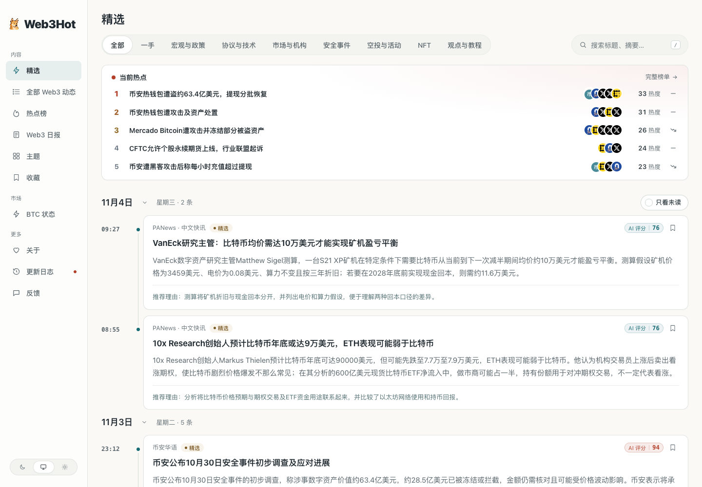
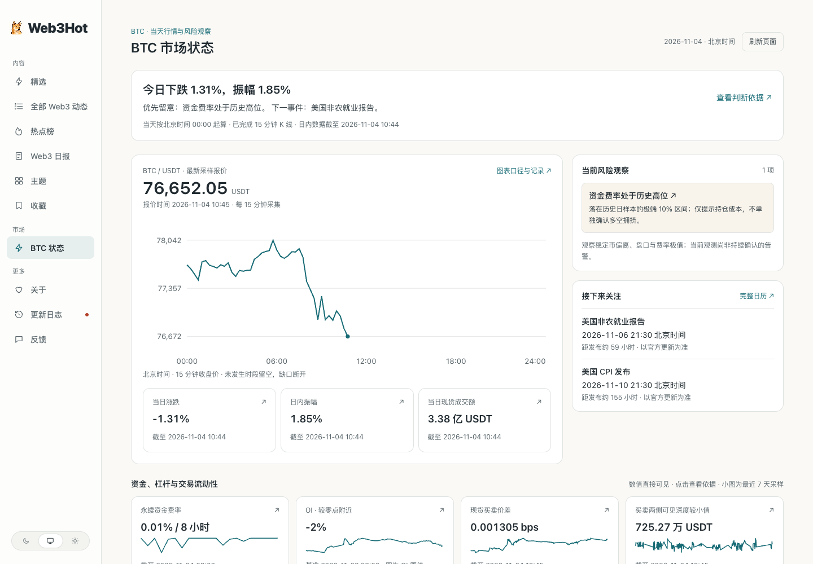
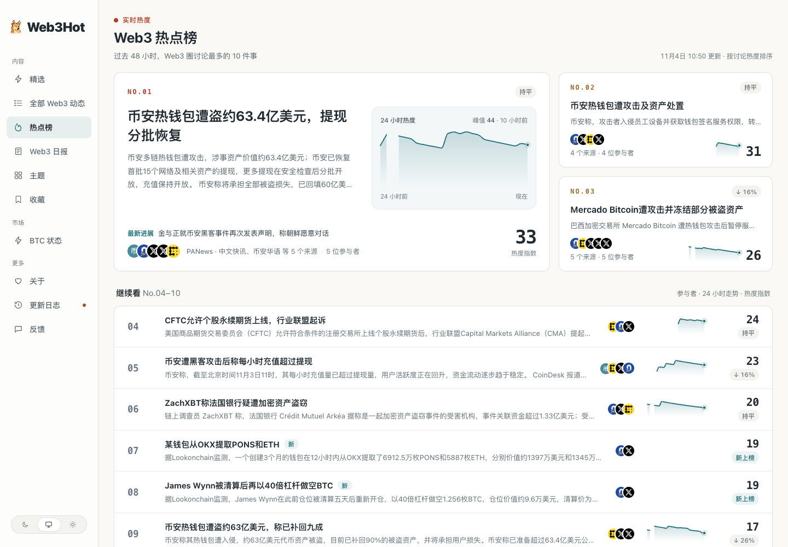
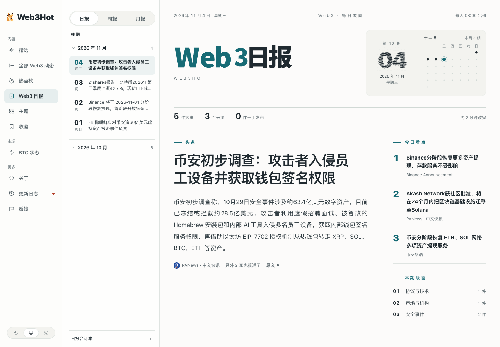

<h1 align="center">Web3Hot</h1>

<p align="center">
  <b>把 Web3 动态汇成热点，把市场数据放在眼前。</b><br>
  精选资讯 · 事件追踪 · Web3 日报 · BTC 市场状态
</p>

<p align="center">
  <a href="https://web3.sqdxw.top">在线体验</a> ·
  <a href="#这是什么">项目介绍</a> ·
  <a href="#看一眼">页面预览</a> ·
  <a href="#跑起来">快速部署</a> ·
  <a href="https://github.com/axiba053/Web3Hot/issues">问题反馈</a>
</p>

<p align="center">
  <a href="https://web3.sqdxw.top"></a>
</p>

## 这是什么

[Web3Hot](https://web3.sqdxw.top) 是一个面向 Web3 的热点聚合网站，基于开源项目 [AIHOT](https://github.com/KKKKhazix/AIHOT) 定制。

它从公开信源持续收集动态，用模型筛选、评分，整理成中文标题和摘要；将不同来源对同一件事的报道归到一起，形成热点和时间线，再编成日报、周报与月报。

在资讯之外，Web3Hot 增加了 **BTC 市场状态看板**，把当天走势、资金费率、持仓、市场情绪和宏观日程放在同一个页面。看新闻，也能顺手看一眼市场正在发生什么。

本仓库包含网站、后台、Web3 分类与信源配置、筛选和写作提示词，以及 BTC 监控模块。

## 它是怎么工作的

**采集 → 判重与预筛 → 两次独立评分 → 中文整理 → 事件归组 → 热点与成刊**

一条资料进入后，先检查是否重复、是否相关，再按评分标准独立评估两次。通过门槛的内容进入精选，并整理出便于阅读的标题、摘要和推荐理由。筛选和写作的提示词保存在 [`industry/prompts/`](industry/prompts/)。

同一件事可能同时出现在项目公告、媒体报道和 X 讨论中。Web3Hot 将相关报道归成一个事件，把后续进展放在一起。热点按事件和独立来源计算，减少同一家媒体重复报道对排序的影响。

日报按规则汇集当天要闻，周报、月报再从日报中汇编。BTC 数据则由独立任务定时采集，页面读取已有观测，并标明数据时间、缺失和过期状态。

## 你会得到什么

| 功能 | 可以做什么 |
| --- | --- |
| **精选与全部动态** | 先读筛选后的重要消息，也可以按时间查看完整动态，通过分类和标签缩小范围 |
| **中文阅读** | 查看中文标题、摘要与推荐理由，沿原文链接追溯消息来源 |
| **事件与热点** | 把同一事件的多方报道和后续进展放在一起，关注当前讨论集中的话题 |
| **日报、周报、月报** | 按不同时间尺度回顾行业进展，减少反复翻阅信息流 |
| **主题与搜索** | 围绕项目、方向与内容类型持续跟踪，查找已有报道 |
| **BTC 市场状态** | 查看当天价格、涨跌、振幅和成交额，以及费率、持仓、情绪、链上指标和宏观日历 |
| **阅读设置** | 支持手机和电脑，提供深浅色外观、字体选择与本机收藏 |
| **管理后台** | 管理信源、检查采集任务、调整模型配置、审核内容，并查看费用回执和运行状态 |

## 看一眼

以下均为 [web3.sqdxw.top](https://web3.sqdxw.top) 的真实页面截图，拍摄于 **2026 年 11 月 4 日**。新闻与行情随时间变化，截图用于展示页面。

### BTC 市场状态

当天走势和关键数值直接展示；指标解释、历史观测和完整日历按需展开。数据不足时保留缺失提示，不把缺失当作零。市场观察不构成投资建议。

<a href="https://web3.sqdxw.top/btc"></a>

<details>
<summary><b>查看热点页面</b>：聚合事件，追踪讨论与进展</summary>
<br>
<a href="https://web3.sqdxw.top/hot"></a>
</details>

<details>
<summary><b>查看日报页面</b>：按天回顾 Web3 要闻</summary>
<br>
<a href="https://web3.sqdxw.top/daily"></a>
</details>

## 跑起来

需要 Docker（带 Compose）和一个 OpenAI 兼容的模型 API Key。建议服务器至少 **2 核、4 GB 内存**；使用初始化脚本时需要 Node.js 24.22.1 或更高版本。

```bash
git clone https://github.com/axiba053/Web3Hot.git
cd Web3Hot
cp .env.example .env
```

在 `.env` 中填写：

- `SITE_URL`：你的站点访问地址，本机试用为 `http://localhost:3000`。
- `ADMIN_PASSWORD`：至少 12 位的管理员密码。
- `SESSION_SECRET`、`IMG_PROXY_SIGN_SECRET`、`POSTGRES_PASSWORD`：分别生成随机值，可使用 `openssl rand -hex 32`。
- `LLM_BASE_URL`、`LLM_API_KEY`、`LLM_MODEL`：模型服务地址、密钥和模型名称；服务商参数示例见 `.env.example`。

确认配置和预算后，设置 `COLLECT_ENABLED=true`、`MODEL_CALLS_ENABLED=true` 开始采集和处理新闻；使用 BTC 看板时再设置 `BTC_MONITOR_ENABLED=true`。

```bash
docker compose up -d --build
```

打开 <http://localhost:3000>，后台在 `/admin`。首次部署从空数据库开始，运行中的 worker 会按配置采集和处理内容。域名、HTTPS、更新与备份步骤见 [部署说明](docs/deploy.md)。

技术栈：**Node.js 24 · TypeScript · React Router · Fastify · PostgreSQL · pg-boss · Tailwind CSS · Docker Compose**。

## 许可

代码采用 [MIT 许可证](LICENSE)，保留原项目版权声明；第三方素材许可见 [NOTICE](NOTICE)。信源内容归原作者所有，默认展示摘要与原文链接。

## 关于站长

- **站长：** 币圈佬狗，欢迎关注 X 账户 [@crypto_laogo](https://x.com/crypto_laogo)
- **定位：** AI狂热者 加密赌狗
- **友情链接：** [BN alpha 活动](https://bian.sqdxw.top/zh/) · [GitHub](https://github.com/axiba053)

## 致谢

感谢 **[数字生命卡兹克](https://github.com/KKKKhazix)** 开源 **[AIHOT](https://github.com/KKKKhazix/AIHOT)**，提供了从信源采集、内容筛选、事件归组到热点与报告的完整框架。Web3Hot 的 Web3 定制建立在这份工作之上，本说明的组织方式也参考了原项目。
